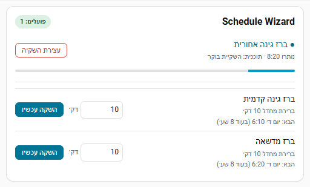

# יכולות

## הפעלה לפי יומן

בוחרים יומן בהגדרות. אירוע מפעיל אזור או תוכנית כשה**כותרת** שלו מכילה את שם האזור או התוכנית כמילים שלמות (אותיות גדולות וקטנות לא משנות). נקראת רק הכותרת, אף פעם לא התיאור, המיקום או המוזמנים.

| כותרת האירוע, לאזור בשם `Front lawn` | מפעיל את האזור? |
| --- | --- |
| `Front lawn` | כן |
| `Front Lawn morning cycle` | כן |
| `Front lawns` | לא (חלק ממילה ארוכה יותר) |
| `Garden zone 1` | לא |

- שם של תו אחד או שני תווים מתאים רק לאירוע שכל הכותרת שלו היא השם הזה בדיוק.
- **תיאור האירוע**: מספר הדקות, כתוב `15 min`, `15 minutes` או `15 דקות`, או פשוט המספר `15`. מספרים אחרים (כמו "Zone 2") לא נחשבים. בלי דקות, נלקח אורך האירוע, ואחריו ברירת המחדל של האזור.
- **מילת מפתח ליומן** (הגדרות ← אפשרויות נוספות ← כוונון לוח השנה): כשהיא מוגדרת, למשל `water:`, רק אירועים שהכותרת שלהם מתחילה בה נספרים, ומחפשים את השם בהמשך הכותרת.
- **ההשקיה הארוכה ביותר מיומן או מ-webhook** (ברירת מחדל 120 דקות): אירוע ארוך יותר מתקצר לערך הזה.
- אירועי יום שלם מתעלמים מהם. מחיקה או הזזה של אירוע מבטלת את ההשקיה הממתינה שלו.
- השהיית גשם, דילוג בגשם, דילוג לפי לחות והתאמה לטמפרטורה נבדקים ברגע שהאירוע מתחיל.

!!! warning "אזהרה"
    כל מי שיכול להוסיף אירוע ליומן שנבחר יכול להפעיל השקיה. אם היומן מאשר הזמנות אוטומטית (Google, Outlook, CalDAV), כדאי להקצות יומן ייעודי להשקיה.

## דילוגים והתאמות

השהיית גשם, דילוג בגשם, דילוג לפי לחות, תנאים והתאמה לטמפרטורה חלים על השקיות מתוזמנות ועל השקיות מיומן. הפעלה ידנית (**השקה עכשיו**) לא מושפעת.

### השהיית גשם

במסך הבית לוחצים **24 שעות**, **48 שעות** או **7 ימים** ובוחרים אם זה חל על כל האזורים או על אזור אחד. השקיות מתוזמנות והשקיות מיומן מדולגות עד שהטיימר מסתיים; הכרטיס מציג את הזמן שנותר וכפתור לניקוי.

אזור שסומן **פנימי** (`rain_exempt: true` ב-`add_valve`) לא מושפע מהשהיית גשם כללית ומדילוג בגשם. תוכנית שמערבבת אזורים פנימיים וחיצוניים ממשיכה לרוץ בזמן השהיה כללית: האזורים הפנימיים מושקים והחיצוניים מדולגים.

```yaml
service: schedule_wizard.set_rain_delay
data:
  hours: 48
  entity_id:
    - switch.zone_front_lawn
    - switch.zone_back_lawn
```

### חיישן גשם

בוחרים בהגדרות ישות מזג אוויר, חיישן גשם או חיישן אחר. שלושה מצבים נבדקים לפי הסדר הזה:

1. **תכונה וסף**: קורא את התכונה (attribute) ומדלג כשהיא שווה לסף או גבוהה ממנו.
2. **סף בלבד**: קורא את המצב כמספר ומדלג כשהוא שווה לסף או גבוה ממנו.
3. **מצבי דילוג**: מדלג כשהמצב תואם אחד מהרשימה (ברירת מחדל `rainy,pouring,snowy,lightning-rainy`). גם `binary_sensor` נחשב לגשם כשהוא במצב `on`.

סף 0 או ריק מכבה את המצבים המספריים. הלוח מציג מה נחשב לגשם, מה המקור מדווח כרגע, והאם ההשקיה הייתה מדולגת עכשיו.

### תחזית גשם

הגדרות ← אפשרויות נוספות ← **דילוג כשצפוי גשם**. בוחרים ישות מזג אוויר שמספקת תחזית, כמות במ״מ וכמה זמן קדימה להסתכל (6, 12, 24 או 48 שעות). התחזית מתרעננת כל 30 דקות; אם אי אפשר לקרוא אותה במשך 3 שעות, לא מדלגים על כלום. אזורים פנימיים והפעלה ידנית אף פעם לא מדולגים.

### לחות קרקע

מגדירים בהגדרות חיישן לחות כללי וסף (מדלגים כשהערך שווה לסף או גבוה ממנו). לאזור אפשר לתת חיישן משלו שגובר על הכללי; בתוך תוכנית כל שלב בודק את האזור שלו.

```yaml
service: schedule_wizard.add_valve
data:
  entity_id: switch.zone_flower_bed
  label: Flower bed
  moisture_entity: sensor.flower_bed_moisture
  moisture_threshold: 45
```

### התאמה לטמפרטורה

משנה את אורך ההשקיות המתוזמנות וההשקיות מיומן בין טמפרטורה נמוכה לגבוהה, בהגבלה לאחוז מינימום ומקסימום. משתמשים בחיישן טמפרטורה, או בישות מזג אוויר עם התכונה `temperature`.

דוגמה: טמפרטורה 18 מעלות, נמוכה 10, גבוהה 30, מינימום 50 אחוז, מקסימום 120 אחוז נותנת `50 + (18 - 10) / (30 - 10) x (120 - 50) = 78` אחוז, ולכן השקיה של 10 דקות נמשכת 8 דקות.

בגורם של **0 אחוז** ההשקיה מדולגת (`skipped_seasonal_zero`). כל גורם גבוה מ-0 עדיין משקה לפחות דקה אחת. במצב כזה מסך הבית מציג "השקיה מתוזמנת מושהית: קריר מדי".

### תנאים ללוח זמנים

לוח זמנים יכול לשאת עד 10 תנאים; כולם חייבים להתקיים ברגע ההפעלה, אחרת ההשקיה מדולגת (`skipped_condition`). ישות לא זמינה נכשלת בתנאי שלה.

| שדה | משמעות |
| --- | --- |
| `entity_id` | כל ישות. |
| `attribute` | אופציונלי; משווים תכונה במקום המצב. |
| `operator` | `above`, `below` (מספרי), `equals`, `not_equals` (מספרי או טקסט ללא הבחנה בין אותיות גדולות לקטנות). |
| `value` | הערך להשוואה. |

```yaml
service: schedule_wizard.add_schedule
data:
  valve_entity_id: switch.zone_lawn
  time: "05:30"
  days: [mon, wed, fri]
  duration_minutes: 20
  conditions:
    - entity_id: sensor.outdoor_temperature
      operator: above
      value: 12
    - entity_id: input_boolean.vacation_mode
      operator: equals
      value: "off"
```

### טיפים לפי מזג האוויר

כשיש ישות מזג אוויר עם תחזית יומית, מסך הבית מציג טיפים להיום ולמחר, לכל אחד כפתור אחד:

- **גשם** (מ-5 מ״מ ו-60 אחוז סיכוי): לדלג על ההשקיות החיצוניות של אותו יום.
- **יום חם** (מ-32 מעלות): להשקות 30 אחוז יותר באותו יום.
- **כפור** (1 עד 2 מעלות ומטה): לדלג על ההשקיות שלפני 10:00.

יש טיפ אחד ביום; גשם קודם וכולל גם כפור. **לא עכשיו** מסתיר טיפ, ו**לא להציע** עוצר סוג שלם של טיפים. הטיפים רק מציעים; שום דבר לא משתנה עד שלוחצים על כפתור. הספים נמצאים בהגדרות ← אפשרויות נוספות ← **טיפים לפי מזג האוויר**. כדי לקבל את הטיפים בערב שלפני כהתראה עם כפתורים, מסמנים **טיפים לפי מזג האוויר (בערב)** תחת **שליחת התראה כש**.

## תוכניות השקיה והשקיה וספיגה

תוכנית מפעילה את האזורים שלה לפי הסדר. לכל אזור אפשר להגדיר **זמן הפעלה מרבי (דק׳)** ו**הפסקת ספיגה (דק׳)**, כדי לפצל השקיות ארוכות למקטעים ולתת למים לחלחל. השקיה של 10 דקות עם מקסימום 4 והפסקה 3 רצה כך: 4, הפסקה 3, 3, הפסקה 3, 3. בתוך תוכנית, האזור הבא מושקה בזמן שאחד מחלחל. כיבוי: הגדרות ← אפשרויות נוספות ← **השקיה וספיגה חכמה**.

```yaml
service: schedule_wizard.add_valve
data:
  entity_id: switch.zone_slope
  label: Slope
  default_duration_minutes: 12
  soak_run_minutes: 4
  soak_pause_minutes: 10
```

אפשר להפעיל תוכנית, להשהות, להמשיך ולעצור מהלוח או בשירותים. תוכנית שהופסקה בגלל הפעלה מחדש ממשיכה באזור הבא אם Home Assistant חזר תוך 30 דקות מהרגע שבו האזור הנוכחי היה אמור להסתיים.

## הגנות

- **ברז ראשי או משאבה**: נפתח לפני כל אזור ונסגר אחרי שהאזור האחרון והתוכנית מסתיימים; אפשר להגדיר השהיה בשניות לפני הפתיחה. חייב להיות מפסק, ברז, תאורה, תריס או input_boolean.
- **בדיקת פתיחה**: אחרי שהברז מקבל פקודת הפעלה, מחכים עד N שניות שידווח שהוא פתוח. אם לא, נרשמת שגיאה, נשלח האירוע `schedule_wizard_valve_failed_to_open` ומתקבלת התראה.
- **זיהוי דליפה ופיצוץ**: בוחרים חיישן זרימה, סף דליפה (זרימה כשאין השקיה), זרימה מרבית בזמן השקיה והשהיה (ברירת מחדל 60 שניות). בהתראה נשלח האירוע `schedule_wizard_leak_detected`, מתקבלת התראה, ואפשר גם לעצור הכול ולסגור את הברז הראשי.
- **עצירת הכול**: סוגרת כל אזור ומסיימת כל תוכנית ורצף ספיגה.
- **הפעלה מחדש**: ההשקיות הפעילות נטענות מהאחסון. ברז פתוח שנשאר לו זמן מקבל מחדש סגירה אוטומטית; ברז שהזמן שלו עבר נסגר מיד; ברז סגור נרשם כמבוטל.

## צריכת מים

עם מד זרימה, המים של כל השקיה נמדדים. בלי מד, מגדירים באזור **ספיקה (ליטר/דקה)** והצריכה מוערכת לפי זמן ההשקיה. את `sensor.<zone>_water_used` ואת `sensor.schedule_wizard_water_used` (ליטרים) אפשר להוסיף ללוח האנרגיה תחת צריכת מים. אחרי 3 השקיות שנמדדו האזור לומד את הזרימה הרגילה שלו, והשקיה עם פחות מחציה ממנה מפעילה את `schedule_wizard_low_flow`.

## Webhook

לכל התקנה יש מזהה webhook ייחודי. את הכתובת מוצאים בהגדרות ← אפשרויות נוספות ← Webhook (למנהלים בלבד). המזהה הוא הסוד; **כתובת חדשה** מחליפה אותו.

```bash
curl -X POST https://<your-ha-url>/api/webhook/<WEBHOOK_ID> \
  -H 'Content-Type: application/json' \
  -d '{"entity_id": "switch.front_lawn_valve", "duration_minutes": 15}'
```

לעצירה משתמשים ב-`"action": "stop"`. מתקבלים רק אזורים שהוגדרו ב-Schedule Wizard (אחרת `404 unknown zone`, לאזור מושבת `409`, ולגוף בקשה פגום `400`).

## שליטה בקול (Assist)

זמינה באנגלית, בגרמנית ובעברית. שמות אזורים ותוכניות מזוהים בגמישות.

| English | Deutsch | עברית |
| --- | --- | --- |
| Water the front lawn for 10 minutes | Bewässere den Rasen für 10 Minuten | תשקה את הדשא 10 דקות |
| Stop watering | Stoppe die Bewässerung | עצור את ההשקיה |
| Skip watering today | Bewässerung heute überspringen | דלג על ההשקיה היום |
| Pause watering for 2 days | Pausiere die Bewässerung für 2 Tage | השהה את ההשקיה ל 2 ימים |

מכבים את הפקודות הקוליות בהגדרות ← אפשרויות נוספות ← **פקודות קוליות (Assist)**.

## התראות

בוחרים שירות `notify.*` אחד או יותר בהגדרות ← התראות, ואז מסמנים אילו אירועים ישלחו הודעה (תחילת וסיום השקיה, תחילת וסיום תוכנית, דילוג בגלל גשם, לחות, תנאים או טמפרטורה, כשל בפתיחה, השהיית גשם, דליפות). ההודעות נכתבות בשפה של Home Assistant.

**תזכורת לפני השקיה** (10 עד 60 דקות) שולחת הודעה כמו "Morning watering starts at 06:00 (35 min)" עם כפתורים **דילוג היום** ו**השקה עכשיו**. הכפתורים דורשים את אפליקציית Home Assistant; שירותי התראה אחרים מקבלים טקסט בלבד.

## כרטיס Lovelace




הכרטיס נרשם אוטומטית. מוסיפים אותו מבורר הכרטיסים, או ב-YAML:

```yaml
type: custom:schedule-wizard-card
title: Irrigation
show_active: true
show_quick_run: true
valves:
  - switch.front_lawn_valve
  - switch.back_lawn_valve
```

| אפשרות | ברירת מחדל | משמעות |
| --- | --- | --- |
| `title` | `Schedule Wizard` | כותרת הכרטיס. |
| `show_active` | `true` | להציג בראש הכרטיס את האזורים שמשקים עכשיו. |
| `show_quick_run` | `true` | להציג את רשימת האזורים עם הדקות וכפתור **השקה עכשיו**. |
| `valves` | כל האזורים | רשימה אופציונלית של מזהי ישויות להצגה. |
