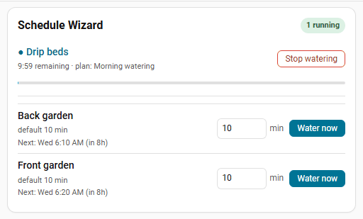

# Features

## Calendar-driven runs

Pick a calendar in Settings. An event starts a zone or plan when its **summary** contains the zone label or plan name as **whole words** (case does not matter). Only the summary is read, never the description, location or attendees.

| Summary for label `Front lawn` | Starts the zone? |
| --- | --- |
| `Front lawn` | yes |
| `Front Lawn morning cycle` | yes |
| `Front lawns` | no (part of a longer word) |
| `Garden zone 1` | no |

- A label or name of 1 or 2 characters only matches an event whose whole summary is exactly that label.
- **Description**: minutes to run, written as `15 min`, `15 minutes` or `15 דקות`, or just the number `15`. Other numbers (like "Zone 2") are ignored. If there are no minutes, the event length is used, then the zone's default.
- **Calendar keyword** (Settings → More options → Calendar fine-tuning): when set, for example `water:`, only events whose title starts with it count, and the name is matched in the rest of the title.
- **Longest calendar or webhook run** (default 120 minutes): a longer event is shortened to it.
- All-day events are ignored. Deleting or moving an event cancels its pending run.
- Rain delay, rain skip, moisture skip and seasonal adjustment are checked when the event fires.

!!! warning
    Anyone who can put an event on the selected calendar can start watering. If your calendar accepts invitations automatically (Google, Outlook, CalDAV), use a dedicated calendar for watering.

## Skipping and adjusting

Rain delay, rain skip, moisture skip, conditions and seasonal adjustment apply to scheduled and calendar runs. Manual runs (**Water now**) are not affected.

### Rain delay

On Home, press **24h**, **48h** or **7d** and choose whether it applies to all zones or one zone. Scheduled and calendar runs are skipped until the timer ends; the card shows the time left and a **Clear** button.

Mark a zone **Indoor** (`rain_exempt: true` in `add_valve`) and the global rain delay and rain skip do not apply to it. A plan that mixes indoor and outdoor zones still runs during a global delay: indoor steps water, outdoor steps are skipped.

```yaml
service: schedule_wizard.set_rain_delay
data:
  hours: 48
  entity_id:
    - switch.zone_front_lawn
    - switch.zone_back_lawn
```

### Rain sensor

Pick a weather entity, rain sensor or other sensor in Settings. Three modes are checked in this order:

1. **Attribute + threshold**: reads the attribute and skips when it is at or above the threshold.
2. **Threshold only**: reads the state as a number and skips when it is at or above the threshold.
3. **Skip states**: skips when the state matches one in the list (default `rainy,pouring,snowy,lightning-rainy`). A `binary_sensor` also counts as rain while it is `on`.

A threshold of 0 or blank turns the numeric modes off. The panel shows what counts as rain, what the source reports now, and whether watering would be skipped right now.

### Rain forecast

Settings → More options → **Skip when rain is forecast**. Pick a weather entity that provides forecasts, the amount in mm and how far ahead to look (6, 12, 24 or 48 hours). The forecast is refreshed every 30 minutes; if it cannot be read for 3 hours, nothing is skipped. Indoor zones and manual runs are never skipped.

### Soil moisture

Set a global moisture sensor and a threshold in Settings (skip when the value is at or above it). A zone can have its own sensor, which overrides the global one; inside a plan, each step checks its own zone.

```yaml
service: schedule_wizard.add_valve
data:
  entity_id: switch.zone_flower_bed
  label: Flower bed
  moisture_entity: sensor.flower_bed_moisture
  moisture_threshold: 45
```

### Temperature adjustment

Scales the length of scheduled and calendar runs between a low and a high temperature, clamped to a minimum and maximum percentage. Use a temperature sensor, or a weather entity with the attribute `temperature`.

Example: temperature 18 °C, low 10, high 30, min 50 %, max 120 % gives 50 + (18 - 10) / (30 - 10) x (120 - 50) = 78 %, so a 10-minute run lasts 8 minutes.

With a factor of **0 %** the run is skipped (`skipped_seasonal_zero`). Any factor above 0 % still waters at least 1 minute. Home then shows "Scheduled watering paused: too cool".

### Schedule conditions

A schedule can carry up to 10 conditions; all must be true when it fires, or the run is skipped (`skipped_condition`). An unavailable entity fails its condition.

| Field | Meaning |
| --- | --- |
| `entity_id` | Any entity. |
| `attribute` | Optional; compare an attribute instead of the state. |
| `operator` | `above`, `below` (numeric), `equals`, `not_equals` (numeric or case-insensitive text). |
| `value` | Value to compare against. |

```yaml
service: schedule_wizard.add_schedule
data:
  valve_entity_id: switch.zone_lawn
  time: "05:30"
  days: [mon, wed, fri]
  duration_minutes: 20
  conditions:
    - entity_id: sensor.outdoor_temperature
      operator: above
      value: 12
    - entity_id: input_boolean.vacation_mode
      operator: equals
      value: "off"
```

### Weather tips

With a weather entity that has a daily forecast, Home shows tips for today and tomorrow, each with one button:

- **Rain** (from 5 mm and 60 % chance): skip the day's outdoor runs.
- **Hot day** (from 32 °C): water +30 % that day.
- **Frost** (1 to 2 °C or below): skip the runs before 10:00.

There is one tip per day; rain comes first and covers frost. **Not now** hides a tip and **Don't suggest** stops that kind. Tips only suggest; nothing changes until you press a button. Thresholds are under Settings → More options → **Weather tips**. To get the tips the evening before as a notification with buttons, tick **Weather tips (evening)** under **Send notification when**.

## Watering plans and cycle & soak

A plan runs its zones in order. Per zone you can set **Max run (min)** and **Soak pause (min)** so long runs are split into chunks and the water sinks in. A 10-minute run with max run 4 and pause 3 runs 4, pause 3, 3, pause 3, 3. Inside a plan, the next zone waters while one soaks. Turn this off in Settings → More options → **Smarter cycle & soak**.

```yaml
service: schedule_wizard.add_valve
data:
  entity_id: switch.zone_slope
  label: Slope
  default_duration_minutes: 12
  soak_run_minutes: 4
  soak_pause_minutes: 10
```

Plans can be started, paused, resumed and stopped from the panel or with services. A plan interrupted by a restart continues with its next zone if Home Assistant is back within 30 minutes of when the current zone would have finished.

## Protection

- **Master valve / pump**: opens before any zone and closes after the last zone and plan finish; optional pre-open delay in seconds. It must be a switch, valve, light, cover or input_boolean.
- **Fail-to-open check**: after turning a valve on, waits up to N seconds for it to report on. If it does not, it logs an error, fires `schedule_wizard_valve_failed_to_open` and notifies.
- **Leak and burst detection**: pick a flow sensor, a leak threshold (flow with nothing watering), a maximum flow while watering and a delay (default 60 s). On an alert it fires `schedule_wizard_leak_detected`, notifies, and can stop everything and close the master valve.
- **Stop all**: closes every valve and ends every plan and soak sequence.
- **Restarts**: active runs are re-armed from storage. A valve that is on with time left gets its auto-close re-armed; one past its end is closed at once; one that is off is logged as cancelled.

## Water usage

With a flow meter, each run's water is measured. Without one, set **Flow rate (L/min)** on a zone and usage is estimated from the run time. `sensor.<zone>_water_used` and `sensor.schedule_wizard_water_used` (litres) can be added to the Energy dashboard under Water consumption. After 3 measured runs a zone learns its usual flow, and a run with less than half of it fires `schedule_wizard_low_flow`.

## Webhook

Each install has a unique webhook ID. Find the URL in Settings → More options → Webhook (administrators only). The ID is the secret; **New URL** replaces it.

```bash
curl -X POST https://<your-ha-url>/api/webhook/<WEBHOOK_ID> \
  -H 'Content-Type: application/json' \
  -d '{"entity_id": "switch.front_lawn_valve", "duration_minutes": 15}'
```

Use `"action": "stop"` to stop. Only zones set up in Schedule Wizard are accepted (`404 unknown zone` otherwise, `409` for a disabled zone, `400` for a bad body).

## Voice (Assist)

Available in English, German and Hebrew. Zone and plan names are matched loosely.

| English | Deutsch | עברית |
| --- | --- | --- |
| Water the front lawn for 10 minutes | Bewässere den Rasen für 10 Minuten | תשקה את הדשא 10 דקות |
| Stop watering | Stoppe die Bewässerung | עצור את ההשקיה |
| Skip watering today | Bewässerung heute überspringen | דלג על ההשקיה היום |
| Pause watering for 2 days | Pausiere die Bewässerung für 2 Tage | השהה את ההשקיה ל 2 ימים |

Turn voice off in Settings → More options → **Voice commands**.

## Notifications

Pick one or more `notify.*` services in Settings → Notifications, then tick which events should send a message (valve start and end, plan start and end, skips for rain, moisture, conditions or temperature, failed open, rain delay, leaks). Messages use your Home Assistant language.

**Remind me before watering** (10 to 60 minutes) sends "Morning watering starts at 06:00 (35 min)" with **Skip today** and **Water now** buttons. The buttons need the Home Assistant Companion app; other notify services get the text only.

## Lovelace card




The card is registered automatically. Add it from the card picker, or in YAML:

```yaml
type: custom:schedule-wizard-card
title: Irrigation
show_active: true
show_quick_run: true
valves:
  - switch.front_lawn_valve
  - switch.back_lawn_valve
```

| Option | Default | Meaning |
| --- | --- | --- |
| `title` | `Schedule Wizard` | Card header. |
| `show_active` | `true` | Show running zones at the top. |
| `show_quick_run` | `true` | Show the zone list with minutes and **Water now**. |
| `valves` | all zones | Optional list of zone entity ids to show. |
