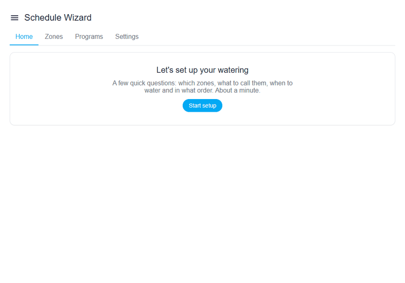

# Schedule Wizard

Schedule Wizard היא **אינטגרציה מותאמת אישית** (custom integration) ל-Home Assistant שמפעילה תזמון להשקיה: ברזים, מפסקים, תאורה ותריסים. היא מפעילה ישויות לפי לוח זמנים חוזר או לפי אירועים ביומן, סוגרת אותן בתום הזמן שהוגדר, וממשיכה לעבוד גם אחרי הפעלה מחדש של Home Assistant. היא מתאימה לכל סוגי ההתקנה (HAOS, Supervised, Container, Core).

## למה זה שימושי

אוטומציות רגילות יודעות לפתוח ברז בשעה קבועה, אבל:

- אין בהן הגנה שסוגרת את הברז אחרי N דקות.
- אין מקום אחד שמראה איזה אזור ישקה בהמשך ואיזה משקה עכשיו.
- השקיה לפי יומן דורשת משך נפרד לכל אירוע, ואין לכך תבנית נוחה.
- הפעלה מחדש של Home Assistant באמצע השקיה עלולה להשאיר ברז פתוח.

Schedule Wizard פותרת את כל אלה באינטגרציה אחת, עם לוח בקרה משלה בסרגל הצד.

## מה מקבלים

- לוחות זמנים לפי ימי השבוע או כל 2 עד 30 ימים, בשעה קבועה או ביחס לזריחה ולשקיעה.
- תוכניות השקיה: כמה אזורים שפועלים בזה אחר זה (או יחד) כתוכנית אחת.
- הפעלה לפי יומן, webhook, שירותים ושליטה בקול דרך Assist.
- דילוגים והתאמות: השהיית גשם, חיישן גשם, תחזית גשם, לחות קרקע, התאמה לטמפרטורה, תנאים ללוח זמנים וטיפים לפי מזג האוויר.
- הגנות: ברז ראשי או משאבה, בדיקה שהברז באמת נפתח, זיהוי דליפה ופיצוץ צינור ממד זרימה, ועצירת הכול.
- לוח בקרה בסרגל הצד, כרטיס Lovelace, ישויות לכל אזור ותוכנית, לוח שנה, אירועים והתראות עם כפתורים.
- הלוח והכרטיס זמינים ב-17 שפות, עם תצוגה מימין לשמאל בעברית ובערבית.

## דרישות

- Home Assistant בגרסה **2024.7.0** ומעלה.
- מפסק, ברז, תאורה, תריס או input_boolean לכל אזור.
- HACS, אם רוצים להתקין ולעדכן מתוך HACS.

## הצעדים הבאים

1. [התקנת](install.md) האינטגרציה.
2. פותחים את הלוח ועוברים על [אשף ההגדרה](usage.md#setup-wizard).
3. ב[יכולות](features.md) מוסיפים דילוג בגשם, דילוג לפי לחות ועוד.

!!! note "הערה"
    קוד המקור, הבעיות והגרסאות נמצאים ב-[GitHub](https://github.com/bareli/schedule_wizard). הפרויקט בקוד פתוח (MIT).
