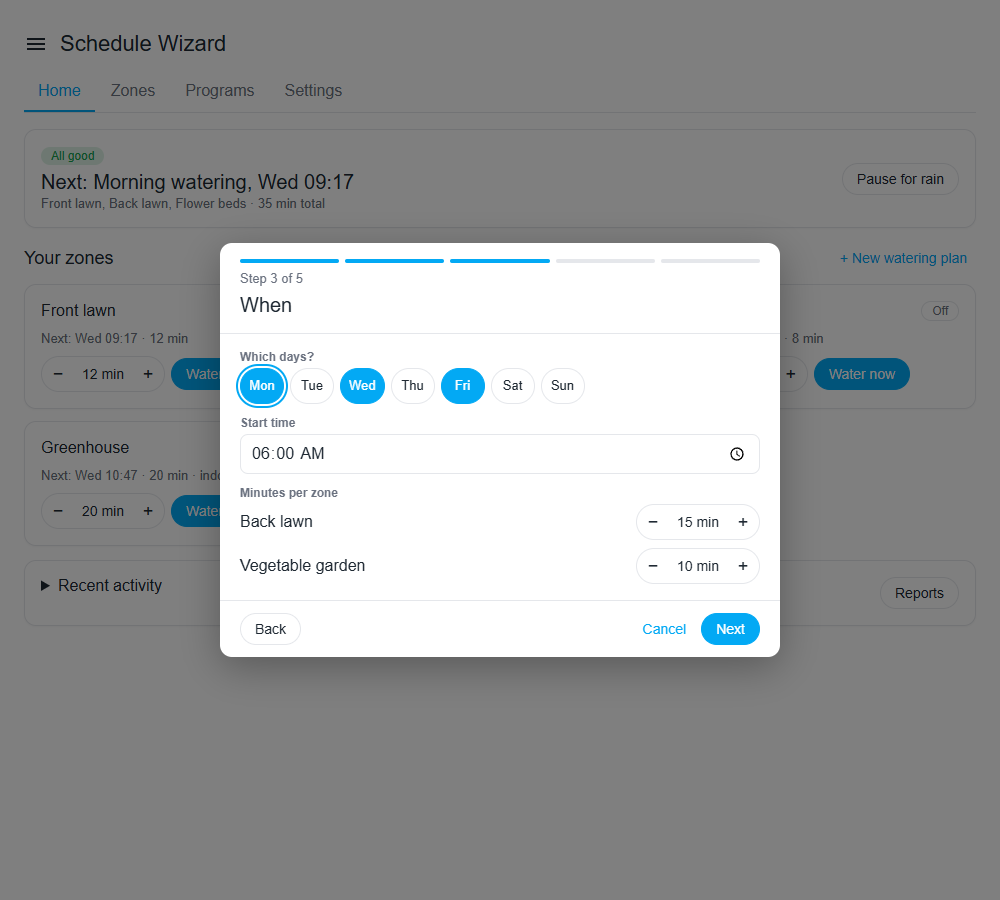
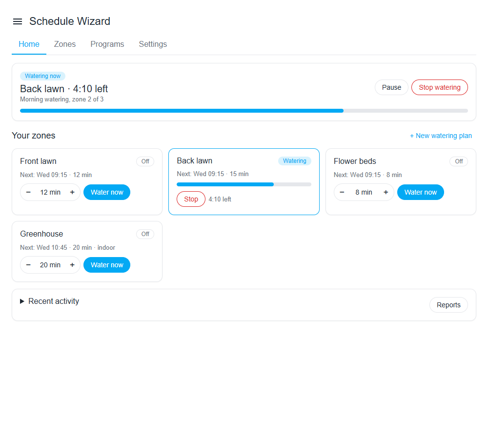
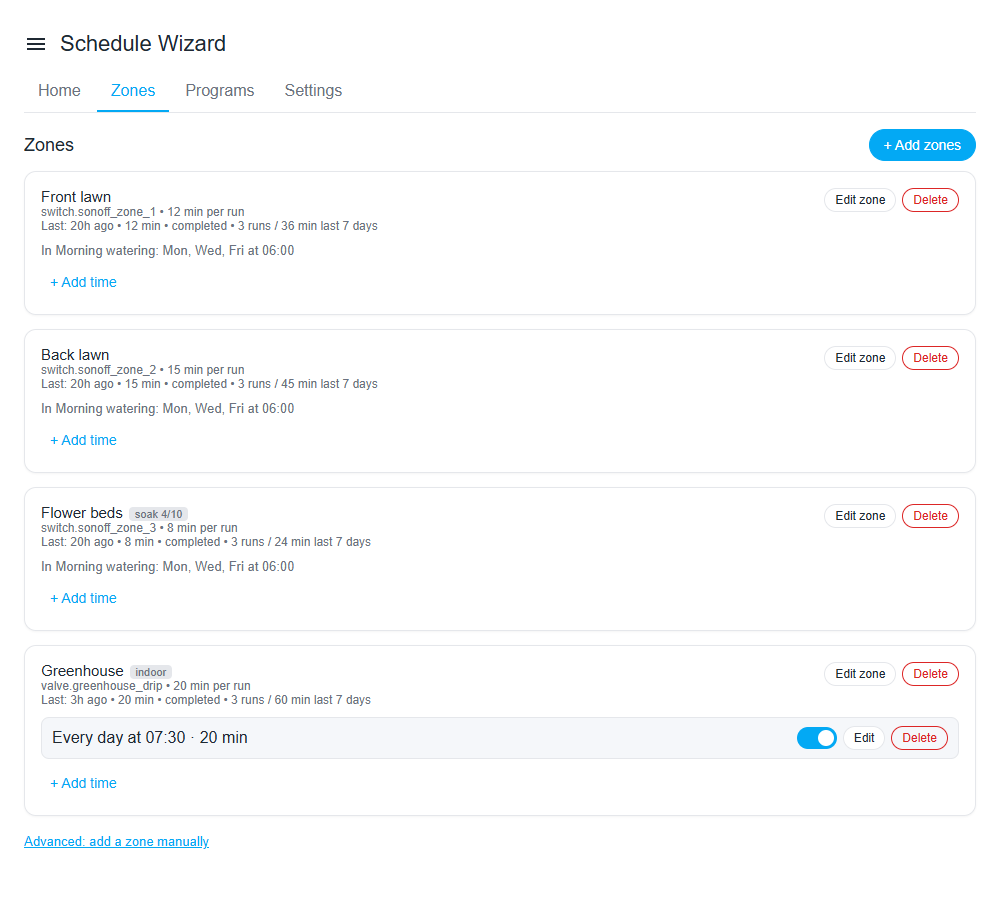
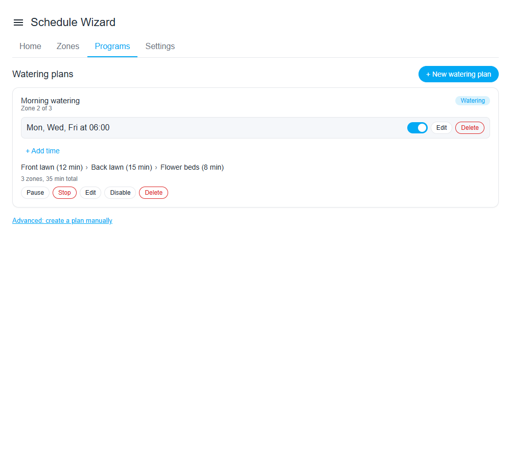
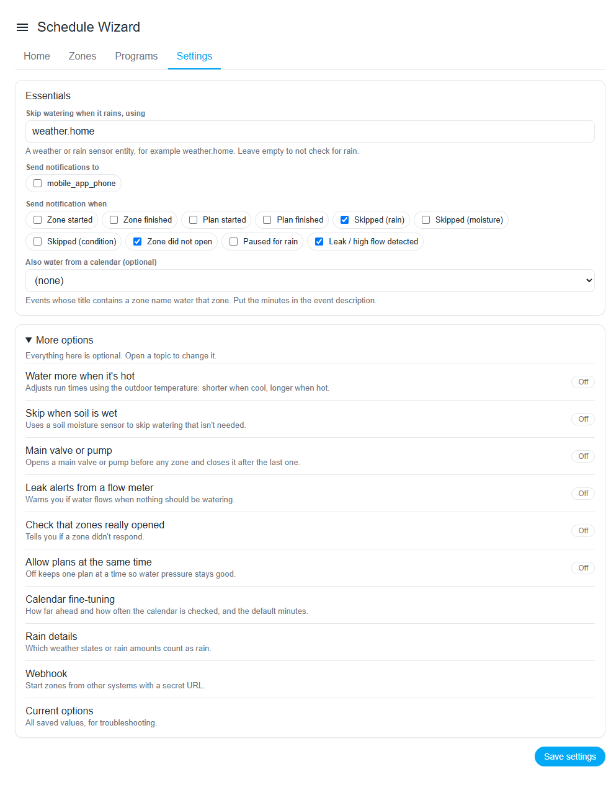

# Usage

After installation, **Schedule Wizard** appears in the sidebar. The panel uses plain words: a **zone** is one valve or switch, and a **watering plan** is a set of zones that water on the same days and time. The main tabs are Home, Zones, Plans and Settings; Reports opens from Home.

## Setup wizard

The first time you open the panel, **Start setup** walks you through four short steps:

1. Tick your switches. A new zone gets its name right there.
2. Choose when: days of the week or every 2 to 30 days, at a set time or at sunrise or sunset (with minutes before or after), and the minutes per zone.
3. Choose **one zone at a time** or **all together**, and name the plan.
4. Check and save. If no rain source is set yet, this step also asks which weather or rain sensor should skip watering when it rains.

It creates the zones, the plan and its schedule. Run it again any time with **+ New watering plan**.

## Home

One status card at the top: watering now (with time left and Stop), paused for rain, or the next run. Below it:

- The last watering, and a card for each zone with its minutes and **Water now**. Each zone shows the next run that will really water.
- Pause for rain (all zones or one zone) and stop everything.
- Recent activity by day (**Today / Yesterday / Last 7 days**) with a total per day.
- **Reports**.

A run started with **Water now** reads "manual (Water now)"; one started by an automation reads "service".

## This week, overlaps and timeline

**This week** lists each run with the minutes it will really water (after the temperature adjustment and any boost), litres per day when flow rates are set, the day's forecast and runs likely to be skipped for rain. Skip or undo a single run or a whole day from there.

Runs that water at the same time are marked red, because zones watering together share the water pressure. **Timeline** shows one day as lanes per zone. The watering time editor warns about overlaps and offers the first free time. To make overlapping runs wait for each other, set **Settings → More options → Watering at the same time → Zones at once**.

## Change one run, or water more or less

- **Water more / less** on the Home status card waters every scheduled run more or less (+20, +30, +50 % or -20, -30 %) for 1, 2, 3 or 7 days, then ends by itself. **Water now** is never changed.
- To change one run only, tap it in **This week** and choose **This time only**: move it to another time the same day, or water 50 to 200 % of its minutes. The schedule stays as it is, and **Undo change** puts the run back.

## Zones

Every zone with its schedule written out, for example "Mon, Thu at 06:00 · 10 min". Edit a zone (name, minutes, indoor, split long runs, its own moisture sensor, flow rate) and add or change its times.

## Plans

Your watering plans, with the zones in order. Each plan has **Run now**, Pause and Stop, **Edit plan** and **Delete plan**. Its **Watering times** are listed below, each with Skip next, on/off, **Edit time** and **Delete time**.

## Every N days

In a watering time's editor, set **Repeat** to **Every 2 to 30 days** instead of **Days of the week**, then pick the **days between waterings** and **First watering on** (today by default). A line under the fields shows the first run. Days are counted on the calendar in your Home Assistant time zone, so runs keep their clock time when daylight saving time changes.

## Sunrise and sunset

Set **Start at** to **Sunrise** or **Sunset**, enter the **Minutes** (0 to 180) and pick **before** or **after**. The start time is worked out for each day from your Home Assistant location and time zone. A line under the fields shows the next three start times.

- A start that the offset would push past midnight runs on its own day at 00:00 or 23:59.
- On a day without a sunrise or sunset (polar day or night) the schedule does not run.

## Reports

Opened from Home: a 30-day daily-minutes chart, totals per zone and plan, skip reasons, litres per zone, and a CSV export of the full history.

## Settings

Three essentials: rain sensor, notifications and calendar. Everything else is under **More options**, one group per feature with a one-line explanation: hot-weather adjustment, wet-soil skip, main valve or pump, leak alerts, open-check, watering at the same time, calendar fine-tuning, rain details, weather tips, voice commands and the webhook.

The Home Assistant **Configure** dialog (Settings → Devices & Services → Schedule Wizard → Configure) edits the basic options and does not wipe the advanced settings made in the panel. Settings apply live and do not interrupt a running plan.
